<p align="center">
<picture>
  <source media="(prefers-color-scheme: dark)" srcset="assets/brand/banner-dark.svg">
  
</picture>
</p>

A comprehensive workbench for Claude Code mods. Explore the mod API, trace the interaction of mods in a live session, and learn how to build your own mods from the ground up. "Developer tools" for Claude Code mods.

## Quickstart

**Requirements:**

* Claude Code with mod support (minimum version: 2.1.299), with `claude` on your PATH for the launcher
* Node.js 22 or newer
* macOS or Linux

From a project folder where you'd like to explore the lab (or a scratch folder you've created), run:

```sh
npx claude-mod-lab run
```

This opens an interactive Claude Code session with the lab's plugins loaded and connects it to the explorer in your browser. The plugins are loaded for this session; no marketplace installation is required. Start with the Mod API's **Try it** flow, or type `/mod-lab help` in Claude Code for the command list.

The lab works across the terminal, desktop app, and VS Code, though mod APIs—especially UI features—vary by client and Claude Code version.

<details>
<summary>Desktop and marketplace installation</summary>

To use the lab in the desktop app or sessions started without the launcher, add the marketplace and install the bridge:

```sh
claude plugin marketplace add hesreallyhim/claude-mod-lab
claude plugin install mod-lab-bridge@claude-mod-lab
```

The bridge connects the session to the explorer and installs the lab as a dependency. Enable the plugin in your client and run `/reload-plugins`. `/mod-lab` opens the lab's client pane; `/mod-lab explorer` gives you the browser explorer's address or starts it if needed. Add `--scope local` to the install command to limit installation to the current project.

</details>

## What's Inside

### Mod API Reference and Probes

* A reference for the mod API (`$`), generated from locally available Claude Code TypeScript declarations. The session indicator shows the session and reference versions.
* Over 50 interactive probes let you invoke API methods with custom inputs and inspect their results, recorded dispatches, and source code. Run them in the explorer or with `/mod-lab <probe>`.
* Customizable intercepts let you observe, refuse, answer, rewrite, or delay supported calls from the lab and other plugins.

### Session Inspector

A deep dive into how mods interact with a live session.

* **Turn timeline:** Trace each turn's model requests, tool calls, and results.
* **Streams:** Inspect process output and model-response chunks as they arrive, with timing information.
* **Conversation X-ray:** Inspect conversation records and their inferred audiences; experiment with notes, notices, and compaction.
* **Context ledger:** Measure context usage and inspect system-prompt sections, tools, and plugin contributions.
* **Model workbench:** Try model calls and conversation forks, compare prompt-cache usage, and track plugin model calls and token usage.
* **Agents:** Register and spawn agents, inspect their answers and tool transcripts, and control which types the model can use.
* **Prompt box:** Trace prompt-box events and try example mods that change typing, highlighting, and paste behavior.
* **Settings:** Inspect and change the session settings exposed through the mod API.

### Build

* **Lessons:** Build working mods through tutorials and challenges with step-by-step checks.
* **Workshop:** Enable or disable mods in your lesson workspace.
* **Sandbox:** Edit a mod's hooks, types, and tests in the browser, then validate, type-check, and test it.
* **Gallery:** Explore seven rendering techniques and add editable examples to your project.
* **Installed mods:** Compare plugins' declared capabilities with their observed activity in the session.

---

## The `mod-lab` server

The local server serves the browser explorer and API reference. The `mod-lab-bridge` plugin connects a running Claude Code session to that server: it carries commands from the explorer into the session and sends results and session events back to the browser. Once connected, you can run probes, inspect activity, and use the lab's controls against that live session. Without a connection, you can still browse the available reference and lesson material.

## Connecting and launch options

> [!TIP]
> You can use the lab in an existing Claude Code project. For building mods or working through lessons, we recommend a dedicated directory to keep your experiments and lesson files together. See [Setting up lessons](#setting-up-lessons) for the lesson workspace commands.

`run` accepts an existing project directory and forwards Claude Code options after `--`:

```sh
npx claude-mod-lab run ~/code/my-project -- --model haiku
```

The launcher supplies the lab and project plugin folders through `--plugin-dir`, alongside your Claude Code flags. It creates `.claude/mod-lab/` in the project for editable Gallery and Prompt box examples. Use `npx claude-mod-lab --help` for launcher options.

To browse before connecting a session, run `npx claude-mod-lab` on its own. This starts or opens an explorer without creating project files. Later, `run` connects a new session to an available explorer or starts one for that session. With the bridge already loaded in an existing session, use `/mod-lab explorer` instead.

Each explorer displays one session at a time. If an explorer is occupied, `run` starts a separate one; `run --new` always requests a separate explorer. An explorer started independently stays running until you stop its server with Ctrl-C; one started for a session stops when that session ends.

## Setting up lessons

You can read the lessons without creating a workspace. In a session started with `run`, type `/init-lessons` to enable them in the current project, preserving existing files. You can continue in the same session.

For a dedicated lesson folder:

```sh
npx claude-mod-lab init-lessons ~/mod-lessons
npx claude-mod-lab run ~/mod-lessons
```

The terminal initializer accepts a new, empty, or already initialized lesson directory. Working mods go in `workshop/`, reference solutions in `solutions/`, and progress in `.claude-mod-lab/`. Each lesson starts from a working mod; edit it, let the session reload it as you save, and use the lesson page to check your work. Return later with the same `run` command. See the [lesson guide](learn/README.md) for details.

## Adding and writing mods

In the Gallery or Prompt box page, **Add to project** copies an example into `.claude/mod-lab/<name>/` in a launcher-started project and requests a plugin reload. The copy is yours to edit and remains in the project. Follow the example's command or interaction instructions to try it. File-copy and reload results are shown separately; if a mod does not appear, check those results and confirm that the session was started with `run` in the intended project. Older copies in `.claude/skills/` are preserved and also loaded by the launcher.

The launcher includes **`/mod-bootstrap:mod-bootstrap`**, an authoring skill that scaffolds a mod's manifest, hooks, types, test, and README, then validates and tests it. Ask Claude to help write a mod, or invoke the skill directly. For installation outside launcher-started sessions, see [mod-bootstrap](plugins/mod-bootstrap/README.md).

**Copy as test hooks** turns recorded dispatches into starter hooks for a test of your own mod. Paste them into a `claude-code/testing` test callback, trigger the behavior you want to test, and add assertions. They are not a complete test; streamed or truncated results may need adapting. See [Tests of your own](learn/README.md#tests-of-your-own).

## Updating

To request the latest published package explicitly, use `npx claude-mod-lab@latest run`. Unversioned `npx claude-mod-lab` can use a locally installed version. Add `--pin` when initializing a lesson workspace to install that initializer's exact package version there, or use `npx claude-mod-lab@<version>` to select a release explicitly.

## Contributing

Contributions are welcome. Open an issue to report a bug or suggest a feature. See [CONTRIBUTING.md](CONTRIBUTING.md) for development setup, repository layout, checks, and releases.

## License

MIT &copy; 2026 Really Him (@hesreallyhim)

This project has no affiliation with Anthropic. Claude Code type declarations are not distributed with this project's source code.
