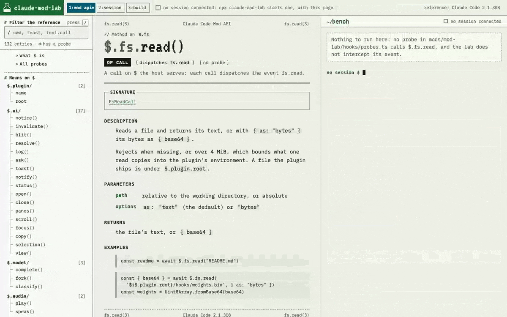
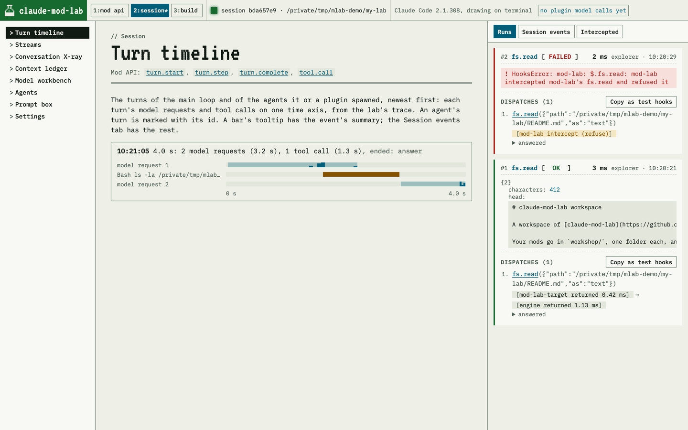
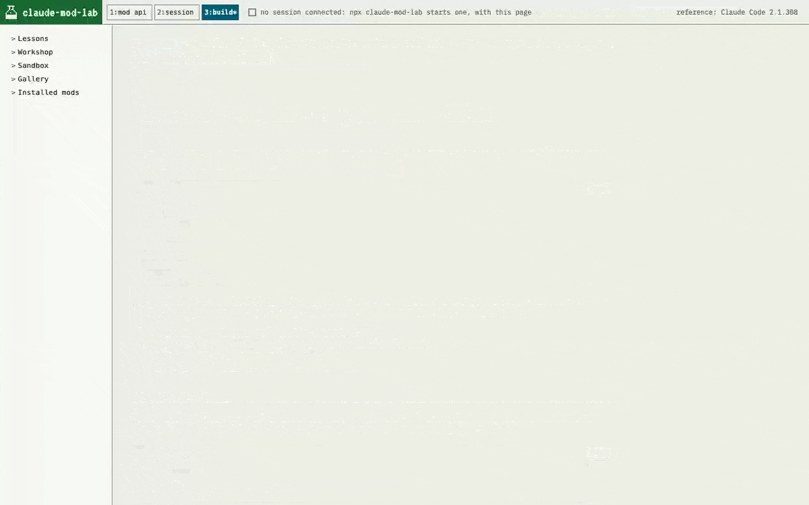
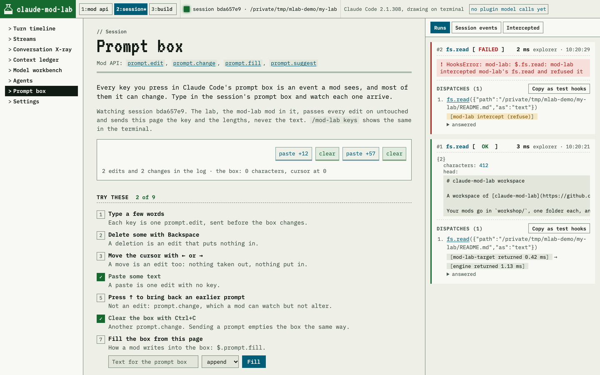

# claude-mod-lab

A hands-on lab for Claude Code mods. Call anything on `$` in a live session and see exactly what happened, watch your session from the inside, and build mods of your own with lessons that check your work every time you save.

Version 0.2.0 is an alpha release. The commands below select the npm `alpha` channel explicitly.

## Get started

Open the explorer from any directory:

```sh
npx claude-mod-lab@alpha
```

This starts the local server and opens the explorer in your browser, or opens the explorer already running. It does not create files in your project. A newly started server stays in this terminal until you press Ctrl-C.

To use the explorer with a project, start Claude Code with the lab loaded:

```sh
cd ~/code/my-project
npx claude-mod-lab@alpha run
```

`run` connects to an available explorer or starts one with the session, so you can use this command on its own. It accepts an existing project directory: `npx claude-mod-lab@alpha run ~/code/my-project`. It creates `.claude/mod-lab/` for Gallery and Prompt box mods and passes that collection to Claude with `--plugin-dir`. Lesson workspaces also load `workshop/` through the same mechanism. Claude Code runs normally, with the lab's tools available when you want them.

You need Claude Code and Node 22 or newer, on macOS or Linux. The lab is loaded only in the sessions the launcher starts. In the session, `/mod-lab` opens its pane and `/mod-lab help` lists its commands.

An explorer started separately remains open when a session ends. An explorer started by the session ends with that session. Each explorer displays one session at a time; if the shared explorer is occupied, `run` starts a separate one and tells you. `run --new` always uses a separate explorer. `serve` is another spelling of the bare command, and `attach` is an alias for `run`.

### Optional: set up the lessons

You can read the lessons in the explorer without creating a workspace. To build and run their mods, explicitly initialize a dedicated folder:

```sh
npx claude-mod-lab@alpha init-lessons ~/mod-lessons
npx claude-mod-lab@alpha run ~/mod-lessons
```

Initialization creates `workshop/`, `.claude-mod-lab/`, a README and a `.gitignore`. The directory must be new, empty, or already initialized for lessons. The session loads the workshop's mods and reloads them as you save. To return later, use the same `run` command.

## What you can do

### Try the API and see what really happens

The lab has 55 probes, each a few lines that call a method on `$` in your session. Run one from the explorer or with `/mod-lab <probe>`, and you see the value it returned, each event it dispatched, and the chain of hooks that answered it. Then put the lab's own hook on that event to watch, refuse, answer, rewrite or delay the call, and run it again.



The reference is built from the declarations of the Claude Code you are running, so it always matches your version. Any run can be copied as test hooks, which stand in for the engine in a test of your own mod.

### Watch your session from the inside

The Session area shows what a mod can see and change while you work: each turn's model requests and tool calls on a timeline, the rows the conversation stores and whether the model or you will read them, what each plugin adds to the model's input, agents, the model calls plugins make and the tokens they use, the prompt box key by key, and settings.



### Learn by building

Eleven tutorials and eight challenges, from a stopwatch you can click to a game of Snake. Each lesson starts from a mod that already runs. You fill in what is missing in your lesson workspace’s `workshop/` directory, the session reloads the mod as you save, and the lesson's page checks every step and tells you what the mod did when a step fails.



### Start from something that works

The Gallery has seven ways a mod can draw beyond plain text, from raster graphics and images to SVG charts and hover cards. The Prompt box page has six mods that change how the prompt box behaves: closing brackets, shortcodes, highlighted slash commands, a guard against pasting API keys, and more. In a session started with `run`, Add to project copies the mod into `.claude/mod-lab/<name>/`, the collection already supplied to Claude at startup. The copy is yours to change and stays in that project until you remove it. The explorer asks the connected session to reload the plugins. Existing Gallery and template copies in `.claude/skills/` stay in place, with their edits preserved, and the launcher explicitly loads those too. Each added mod shows the command or interaction to try it.



### Have Claude help you write mods

`npx claude-mod-lab@alpha run` includes two authoring skills; no marketplace installation is needed. `mod-bootstrap` scaffolds a new mod with its manifest, hooks, types, a test and a README, and checks it before handing it over. `mod-authoring-notes` gives Claude the practical facts about writing mods: what the validator refuses, how the test kit behaves, and what the engine will and won't do. Ask Claude to help write a mod, or invoke `/mod-bootstrap:mod-bootstrap` or `/mod-authoring-notes:mod-authoring-notes` directly.

To use these skills in sessions started without the lab launcher, install them separately:

```sh
claude plugin marketplace add hesreallyhim/claude-mod-lab
claude plugin install mod-bootstrap@claude-mod-lab
claude plugin install mod-authoring-notes@claude-mod-lab
```

## Other ways to run it

To load the lab in sessions started with plain `claude`, or in the desktop app, install it as a plugin:

```sh
claude plugin marketplace add hesreallyhim/claude-mod-lab
claude plugin install mod-lab-bridge@claude-mod-lab --scope local
```

The bridge can join a separately running explorer. `/mod-lab explorer` gives the connected explorer’s address or starts one for the session. `--scope local` keeps the lab to the folder you ran the install in; leave it out to have it in every session. For lesson hot reload, use `init-lessons` followed by `run` so the launcher loads the workshop.

Use `npx claude-mod-lab@0.2.0` to select this exact release instead of following the alpha channel. To pin a lesson workspace to the current package version, use `npx claude-mod-lab@alpha init-lessons <directory> --pin`; this installs that version in the workspace. `npx claude-mod-lab@alpha --help` lists the commands and options.

## Updating and removing

Use `npx claude-mod-lab@alpha` to follow the alpha channel; a workspace initialized with `--pin` keeps its installed version. An installed lab updates through `/plugin`, where you can turn on auto-update for this marketplace under Marketplaces. By hand, `claude plugin update <name>@claude-mod-lab` updates one plugin at a time, so run it for each of mod-lab-bridge, mod-lab, mod-lab-target and mod-lab-keys, then `/reload-plugins`.

To remove the lab, delete your lab folder and `~/.claude-mod-lab/`, where the launcher keeps its copies. An installed lab comes out with `claude plugin uninstall mod-lab-bridge@claude-mod-lab --prune` (add `--scope local` if you installed it that way).

## If /mod-lab doesn't appear

The usual reason is a Claude Code older than the lab supports: update Claude Code and start again. In a session started with `npx claude-mod-lab@alpha run`, a plugin that failed to load says why in the transcript. An installed plugin fails silently, so start Claude Code with `claude --debug-file <path>` and look in that file for "hooks module did not load".

## If an added Gallery or Prompt box mod doesn't appear

Start the lab in the project you want to use (`npx claude-mod-lab@alpha run <project>`). In the explorer, choose Add to project, let the session reload, and follow the mod's “try it” instructions. The launcher supplies the component folder through `--plugin-dir`, just as it supplies the lesson Workshop. You do not need a global installation or a manual trust-settings change for this loading route. A session started before this feature needs to be relaunched to receive the collection path.

“Added to project” confirms that the files were copied; the reload result appears separately. For mods with a command, the card also checks the connected session’s command registry and shows whether that command is available from the expected plugin. Prompt-only mods have no command check. If you reconnect the explorer to a session started outside the launcher, copies in `.claude/mod-lab/` show an instruction to start through `run`. Older copies remain editable in `.claude/skills/`; removing one and adding it again puts the new copy in the collection.

In projects that have never used the launcher, the explorer can still copy into `.claude/skills/`. That automatic discovery route requires trust for the exact project folder. A trusted parent folder can suppress the trust prompt without permitting these plugins; see Claude Code's [exact-folder trust instructions](https://code.claude.com/docs/en/permissions#what-runs-before-you-trust-a-folder). The lab reports these loading diagnostics without changing trust settings. Using `run` explicitly loads known lab copies from that older location.

## Contributing

Work on the lab itself happens in a clone. [CONTRIBUTING.md](CONTRIBUTING.md) covers setup, the checks, how the repository is laid out, and releases.

## License

MIT, for everything in this repository. Claude Code itself, including the declarations the explorer reads, belongs to Anthropic and is not covered by this license. claude-mod-lab is an independent project, not made by Anthropic.
